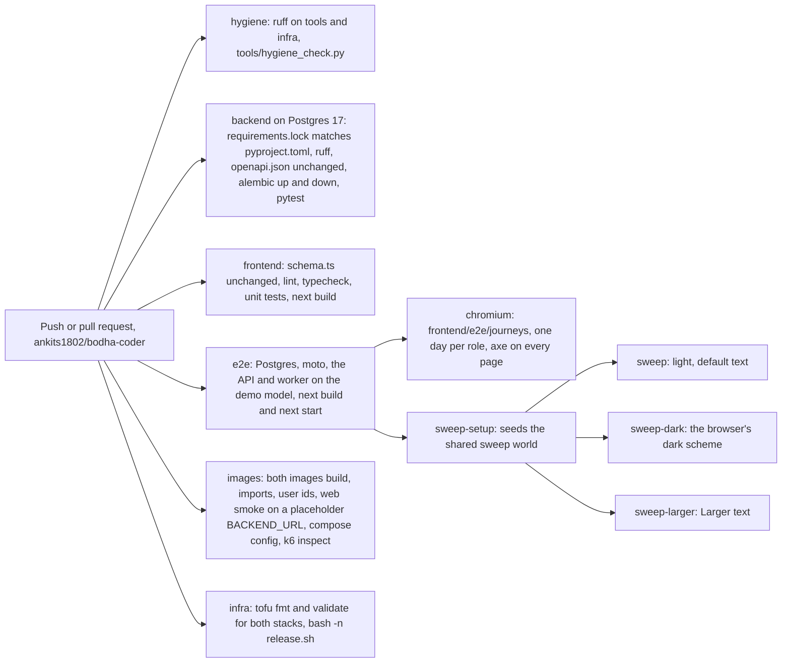
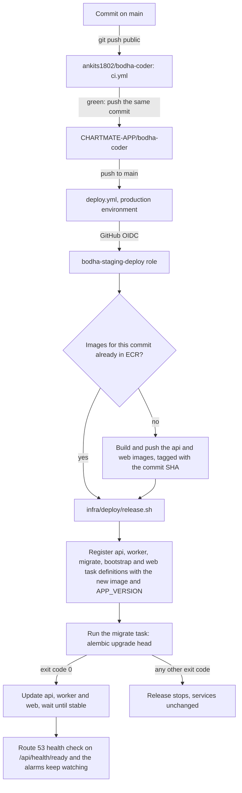

# Deploy

How Bodha Assure is packaged, run locally with Docker Compose, and deployed on AWS. Day-two
procedures are in [OPERATIONS.md](OPERATIONS.md); the load test is in
[tools/load/README.md](../tools/load/README.md). Decision: [0016](decisions/0016-containers-and-deployment.md).

## Images

| Image | Built from | Base | Runs as | Starts |
|---|---|---|---|---|
| `bodha-coder-api` | `backend/Dockerfile` | `python:3.14.10-slim-trixie` | uid 10001 | `api` (default), `worker`, `migrate`, or any command |
| `bodha-coder-web` | `frontend/Dockerfile` | `node:24.22.3-trixie-slim` | uid 1000 | `node server.js` (Next standalone) |

The API image installs the dependencies pinned in `backend/pyproject.toml` from wheels only (the
build fails rather than compile), then the app itself, in a build stage; the final stage holds the
virtual environment, `alembic.ini`, `alembic/` and `docker-entrypoint.sh`, and no compiler or
source tree. One image serves three roles:

| Command | Runs |
|---|---|
| `api` | `uvicorn app.main:app --host 0.0.0.0 --port 8000 --proxy-headers --forwarded-allow-ips $FORWARDED_ALLOW_IPS --workers $WEB_CONCURRENCY --timeout-keep-alive 65 --timeout-graceful-shutdown 25 --no-access-log` |
| `worker` | `python -m app.worker` |
| `migrate` | `alembic upgrade head` |
| anything else | that command, for example `python -m app.scripts.bootstrap_hq` |

`FORWARDED_ALLOW_IPS` defaults to `127.0.0.1` and `WEB_CONCURRENCY` to `1`. Set
`FORWARDED_ALLOW_IPS` to the addresses of the proxies in front of the API (on AWS, the VPC CIDR) so
rate limits and the access log see the visitor's address. The app reads the same setting to decide
whether to believe `X-Forwarded-Host`, which the web server's `/api` rewrite sends with the browser's
host ([0033](decisions/0033-hq-on-its-own-host.md)). When `GOOGLE_CREDENTIALS_JSON` holds a
Google credential (a service account key or a workload identity federation configuration), the
entrypoint writes it to a private temporary file, points `GOOGLE_APPLICATION_CREDENTIALS` at it and
removes the variable, so Vertex AI credentials can come from Secrets Manager. The image's
`HEALTHCHECK` calls `/api/health`; turn it off for `worker` and `migrate` containers.

The web image is built once and pointed at an API at start: `BACKEND_URL` (required, for example
`http://api:8000`) is written into the standalone server's rewrite table before `node server.js`
starts. Next.js fixes rewrites at build time, so the build uses the placeholder
`http://backend-url.invalid`, records every file that contains it, and fails if
`.next/routes-manifest.json` is not one of them. Only those files and `.next/cache` are writable by
the runtime user. The server also reads `BACKEND_URL` at request time to render `/` and `/pricing` with the plan
catalog (kept an hour in `.next/cache`); nothing is fetched at build.

Neither image contains a secret or an `.env` file; both `.dockerignore` files keep them out of the
build context. Tag images with the git commit SHA, push to ECR with immutable tags and scan on
push (OpenTofu's repositories are `bodha-staging-api` and `bodha-staging-web`, keeping the last 20
images). CI builds both images on every push (`images` job) without pushing, and the `e2e` job runs the
browser journeys against a production build of the web app with the API and worker beside it
([0050](decisions/0050-browser-journeys-and-production-canary.md)). Every Python dependency
has arm64 wheels, so `docker buildx build --platform linux/arm64` produces Graviton images when
wanted; CI builds amd64.

## Health and logs

| Endpoint | Answers |
|---|---|
| `GET /api/health` | liveness: `200 {"status": "ok"}` while the process serves requests |
| `GET /api/health/ready` | readiness: `SELECT 1` on the database and `HeadBucket` on the object store, two seconds each; `200` with `{"status": "ready", "checks": {...}}`, or `503` naming the failed check as `unavailable` |

Load balancer and container health checks use liveness. Readiness is for the release smoke check
and synthetic monitoring; never let it restart tasks, or a storage outage restarts every task. The
nightly production canary (`.github/workflows/canary.yml`) checks readiness on both hosts and signs in
read-only as two canary accounts; its accounts and secrets are in
[OPERATIONS.md](OPERATIONS.md#production-canary).

Every process writes one JSON object per line to standard output through
`app/core/logging.py`: `time`, `level`, `logger`, `message`, `request_id` inside a request, and
the event's own fields. The API writes one `bodha.access` line per request with `method`, `route`
(the route template, such as `/api/notes/{note_id}`, or `unmatched`), `status`, `duration_ms` and
`request_id`; uvicorn's own access log is off. A request's `X-Request-ID` is kept when it is 16 to
64 hexadecimal characters or dashes, otherwise a new one is issued, and the response always
carries it.

The access line never carries query strings, raw paths, bodies, headers or client addresses, and
log messages name records by id only, never by email, name or token. Exceptions are logged by
type, the last 20 stack frames and the types of their causes;
their messages are not logged, because messages from the app and its libraries can carry file
names (which include patient names) or SQL parameters.

The worker writes a CloudWatch Embedded Metric Format line once a minute: namespace `BodhaCoder`,
metrics `QueuedAnalyses` (queued and due) and `RunningAnalyses`, no dimensions. CloudWatch Logs
turns these lines into metrics without an agent. Every worker task reports the same counts, so
alarms and scaling use the `Maximum` statistic.

## Local and staging with Docker Compose

`docker-compose.yml` runs Postgres 17, LocalStack (S3, SES and SNS), a one-shot `migrate`, `api`,
`worker` and `web`. Only `web` (`127.0.0.1:3000`) and LocalStack (`127.0.0.1:4566`) are published,
on the loopback address.

1. `copy .env.compose.example .env.compose` and fill in every key. `.env.compose` is ignored by git.

   | Key | Value |
   |---|---|
   | `POSTGRES_PASSWORD` | letters and digits only (it is placed in a URL) |
   | `SECRET_KEY` | `python -c "import secrets; print(secrets.token_urlsafe(48))"` |
   | `MFA_ENCRYPTION_KEY` | `python -c "from cryptography.fernet import Fernet; print(Fernet.generate_key().decode())"` |
   | `CLEARINGHOUSE_ENCRYPTION_KEY` | another key made the same way; empty keeps SFTP connections unavailable (portal downloads still work) |
   | `EHR_KEY_ENCRYPTION_KEY` | optional; the same command, a different key. Empty keeps the EHR connection unavailable |
   | `GEMINI_API_KEY` | a key for test data only |
   | `LOCALSTACK_AUTH_TOKEN` | from a free LocalStack account; LocalStack requires one since its 2026.03 release |
   | `APP_URL`, `COOKIE_SECURE` | leave empty for `http://localhost:3000` and `true` |
   | `ADMIN_URL` | empty keeps HQ on `APP_URL`; `http://admin.localhost:3000` puts HQ on its own host (browsers send `*.localhost` to this machine) |
   | `GOOGLE_CLIENT_ID`, `GOOGLE_CLIENT_SECRET` | empty unless testing Google sign-in |
   | `MICROSOFT_CLIENT_ID`, `MICROSOFT_CLIENT_SECRET`, `MICROSOFT_TENANT` | empty unless testing Microsoft sign-in; the tenant defaults to `common` |
   | `YAHOO_CLIENT_ID`, `YAHOO_CLIENT_SECRET` | empty unless testing Yahoo sign-in |
   | `BOOTSTRAP_HQ_EMAIL`, `BOOTSTRAP_HQ_PASSWORD` | the first HQ account |

2. `docker compose --env-file .env.compose up --build`
3. `docker compose --env-file .env.compose run --rm migrate python -m app.scripts.bootstrap_hq`
4. Open `http://localhost:3000` (HQ at `http://admin.localhost:3000` when `ADMIN_URL` is set).

LocalStack's ready hook (`tools/localstack/init_aws.py`) creates the bucket (versioned, encrypted,
public access blocked) and the SES identity for `MAIL_FROM`; LocalStack reports healthy only after
the hook succeeds. The backend reaches LocalStack through `S3_ENDPOINT_URL` and `AWS_ENDPOINT_URL`
(boto3 sends SES and SNS calls there), both `http://localhost.localstack.cloud:4566`; inside the
network that name is an alias of the LocalStack container, and on the host it resolves to
`127.0.0.1`, so signed PDF links open in the browser. Sent emails are at
`http://localhost:4566/_aws/ses` and texts at `http://localhost:4566/_aws/sns/sms-messages`.

Compose and CI run the API, the worker and the migrations as the one database user (`bodha`), with
no `RUNTIME_DATABASE_PASSWORD`, so no `bodha_runtime` role is created there. The immutability triggers
still refuse changes from that user unless a transaction sets `bodha.maintenance`, which the tests do
only to build old rows.

The compose stack is for test data only. LocalStack is not covered by any business associate
agreement, so real patient documents never go into it. For a shared staging host, put a TLS proxy
in front of `127.0.0.1:3000` and set `APP_URL` to its `https://` address.

## Continuous integration

Every test, type check and build runs on GitHub Actions, never on a development machine. The public
repository runs the checks; the private origin releases.

| Workflow | Repository | When | Does |
|---|---|---|---|
| `ci.yml` | `ankits1802/bodha-coder` | push to `main`, pull requests | the six jobs below |
| `codeql.yml` | `ankits1802/bodha-coder` | push to `main`, Mondays 04:17 UTC, by hand | CodeQL `security-extended` for Python, JavaScript and TypeScript, and the workflows |
| `deploy.yml` | `CHARTMATE-APP/bodha-coder` | push to `main`, by hand | [Releases](#releases-migrations-first) |
| `canary.yml` | `CHARTMATE-APP/bodha-coder` | 08:17 UTC nightly once `CANARY_ENABLED` is `true`, by hand | the read-only production walk ([OPERATIONS.md](OPERATIONS.md#production-canary)) |



The journeys, the sweep and the canary rehearsal are described in
[ARCHITECTURE.md](ARCHITECTURE.md#browser-journeys-and-the-production-canary); a failed `e2e` run keeps
traces, screenshots and the server logs for seven days.

## AWS reference deployment

Production is provisioned from `infra/tofu` with OpenTofu and released by `deploy.yml` from the
CHARTMATE-APP repository ([0025](decisions/0025-staging-on-aws.md), runbook in
[infra/tofu/README.md](../infra/tofu/README.md)). The running system and its connections are drawn in
[ARCHITECTURE.md](ARCHITECTURE.md#system-context). The sections after the next one describe the
reference design that deployment grows into.

### What OpenTofu builds today

One stack, `infra/tofu/envs/production`, is production (`APP_ENVIRONMENT=production`). AWS names keep the
`bodha-staging` prefix and secrets stay under `bodha/staging/`, because renaming would rebuild the
database, load balancer, repositories and secrets ([0025](decisions/0025-staging-on-aws.md)).

| Part | Built today | Reference, below |
|---|---|---|
| Front door | CloudFront for `www.bodhaai.co` and `admin.bodhaai.co` (one ACM certificate, TLS 1.2 or later, HTTP/2 and 3), reaching an internal load balancer on port 80 through a VPC origin; `/_next/static/*` cached, every other path uncached with all viewer headers forwarded; `/api/*` to `api`, the rest to `web` | public load balancer with HTTPS and AWS WAF |
| Network | two zones; tasks in public subnets with public IPs, inbound only from the load balancer; load balancer and database in private subnets; an S3 gateway endpoint; no NAT gateway, so outbound addresses change with each task | three zones, tasks in private subnets behind a NAT gateway per zone, interface endpoints |
| Compute | cluster `bodha-staging`, services `api`, `worker`, `web`, one task each on on-demand Fargate, 0.25 vCPU (`api` and `worker` 1 GB, `web` 512 MB); `web` reaches the API through the load balancer (`BACKEND_URL`); Container Insights off; no autoscaling | the sizes and autoscaling below, Service Connect |
| Database | RDS PostgreSQL 17 `db.t4g.micro`, single zone, gp3 20 GB growing to 200 GB, backups kept 35 days, TLS forced, query values kept out of the logs, deletion protection | Multi-AZ `db.m7g.large` |
| Database roles | `bodha_app` is the master user, owns the schema and migrates; `api` and `worker` connect as `bodha_runtime` once `runtime_database = true` ([infra/tofu/README.md](../infra/tofu/README.md#runtime-database-role)), and as `bodha_app` until then | a separate master user; `bodha_runtime` always |
| Task roles | `api` and `worker` share one role: the documents bucket, the inbound mail objects, the data key, the signing key, SES sending and, once texts are on, `sns:Publish`; `migrate`, `bootstrap` and `web` run with a role that may do nothing | one role per service, below |
| Model | the Gemini Developer API (`GEMINI_BACKEND=developer`, secret `gemini-api-key`); the `gemini_backend` variable accepts only `developer` until Vertex AI credentials are wired | Vertex AI (Agreements, below) |
| Records | documents bucket `bodha-staging-documents-<account>` with versioning and Object Lock (governance, 2557 days); monthly database snapshots in the `bodha-staging-records` vault, locked to 2557 days; a CloudTrail trail with S3 data events into its own Object Lock bucket; log groups kept 2557 days | the same, plus a copy in a separate backup account |
| Email | SES domain identity `bodhaai.co` (Easy DKIM, MAIL FROM `mail.bodhaai.co`), sender `no-reply@bodhaai.co`; email intake on `intake.bodhaai.co` ([infra/tofu/README.md](../infra/tofu/README.md#email-intake)) | the same |
| Texts | off (`SMS_TRANSPORT=outbox`) until `sms_origination_number` is set | SNS with a registered number |
| Watching | a Route 53 HTTPS health check of `/api/health/ready` from three regions; alarms to one SNS topic that emails `alert_email`: API 5xx above 10 in five minutes, unhealthy targets per target group, worker metrics missing, queue stuck (queued with nothing running), database CPU above 80% and free storage under 4 GiB, site down; a CloudWatch dashboard; a monthly budget with alerts at 80% and 100% | the alarm table below |
| Releases | `deploy.yml` on every push to `main` of CHARTMATE-APP, through the `bodha-staging-deploy` role (GitHub OIDC, the `production` environment) | Releases, below |

### Agreements

- **AWS**: accept the AWS Business Associate Addendum in AWS Artifact for every account that
  stores or processes PHI, and use only HIPAA eligible services. Everything below (VPC, ELB, ECS on
  Fargate, ECR, RDS, S3, KMS, Secrets Manager, CloudWatch, CloudTrail, SES, SNS and AWS End User
  Messaging SMS, AWS Backup, WAF) is on the list today; check the current list before go-live.
- **Google**: sign the Google Cloud BAA for the production project and run the worker with
  `GEMINI_BACKEND=vertex` ([0012](decisions/0012-vertex-ai.md)): Gemini on Vertex AI is a covered
  service, the Gemini Developer API (`GEMINI_API_KEY`) is not, so it is for test data only. Use a
  regional US `GOOGLE_CLOUD_LOCATION`, keep the project to covered services, turn off Vertex AI data
  caching and request the abuse-monitoring logging exemption for zero data retention. The worker's
  Google identity is a service account with `roles/aiplatform.user` on that project only.
- **Twilio**, if used instead of SNS, needs its own BAA review; messages carry links and codes,
  never patient details.
- Keep production and staging in separate AWS accounts and Google projects. Staging holds synthetic
  data only.

### Network

- One VPC across three Availability Zones: public subnets for the ALB and a NAT gateway per zone,
  private subnets for the tasks, isolated subnets for RDS.
- Security groups: ALB accepts 443 (and 80, redirected) from the internet; `web` accepts 3000 from
  the ALB; `api` accepts 8000 from the ALB and from `web`; RDS accepts 5432 from `api` and
  `worker` (the `migrate` task uses the worker's group).
- VPC endpoints keep AWS traffic private: S3 (gateway), and interface endpoints for ECR (api and
  dkr), CloudWatch Logs, Secrets Manager, KMS, STS, SES (`email`) and SNS. Vertex AI, Google
  sign-in and Twilio leave through the NAT gateway, and so does SFTP to the clearinghouses practices
  connect (`api` for Read host key, Test connection and Send claims; `worker` for the response
  folders). The tasks' outbound rule already allows it; the application itself refuses any host that
  resolves to a private, loopback or link-local address, so a practice cannot reach the VPC
  ([0051](decisions/0051-clearinghouse-837p.md)). A clearinghouse that allows SFTP only from listed
  addresses needs the NAT gateways' Elastic IPs.
- Requests to practices' EHRs leave the same way (`api` for Save and Test connection, `worker` for the
  pulls) and go only to public https addresses ([0060](decisions/0060-ehr-connection-over-fhir.md)); an
  EHR that allows only listed addresses needs the same Elastic IPs. The OpenTofu deployment still runs
  tasks in public subnets with addresses that change with each task, so neither allow-list works there
  until it has NAT gateways.

### Load balancer

- HTTPS listener with an ACM certificate and `ELBSecurityPolicy-TLS13-1-2-2021-06`; the HTTP
  listener only redirects to HTTPS. Set the listener's `Strict-Transport-Security` response header.
- Rules: `/api/*` to the `api` target group (health check `/api/health`), everything else to the
  `web` target group (health check `/sign-in`). The API is reached directly, so uploads do not pass
  through the Next.js proxy and its timeout.
- Idle timeout 120 seconds (large uploads), drop invalid header fields, desync mitigation
  `strictest`, deletion protection on.
- AWS WAF with the managed common, known-bad-inputs and IP reputation rule groups, and a
  rate-based rule on `/api/auth/*` in front of the app's own limits.
- ALB access logs record full request URLs, and the queue search sends what people type (often a
  patient name) in the query string. Either leave access logs off or send them to a bucket handled
  as PHI (SSE-KMS, restricted, same lifecycle as the documents).

### ECS on Fargate

One cluster with Container Insights on (scaling uses its `RunningTaskCount`).

| Service | Command | Size | Tasks | Notes |
|---|---|---|---|---|
| `api` | `api` | 1 vCPU, 2 GB | 2 to 6, two zones | target group port 8000; `WEB_CONCURRENCY=1`; scale on CPU 60% |
| `worker` | `worker` | 1 vCPU, 2 GB | 1 to 4 | no load balancer; container health check off; scales on the queue (below) |
| `web` | default | 0.5 vCPU, 1 GB | 2 to 4, two zones | target group port 3000; `BACKEND_URL=http://api:8000` |

- Service Connect publishes `api` as `api:8000` inside the namespace, which is what `web` uses.
- Task definitions: `awslogs` driver to one log group per service, `initProcessEnabled: true`,
  `stopTimeout` 30 seconds for `api` and `web` and 120 for `worker`. `api` and `worker` run with
  `readonlyRootFilesystem: true` and an ephemeral volume at `/tmp` (uploads are spooled there);
  `web` rewrites its route table at start and so keeps a writable root.
- Deployments: rolling with minimum healthy 100% and maximum 200%, and the deployment circuit
  breaker with rollback.
- ECS Exec stays off for `api` and `worker` in production; turn it on only for a recorded
  break-glass session, with session logging to an encrypted log group.
- The execution role pulls from ECR, writes the log groups, and reads exactly the secrets its task
  definition references (with `kms:Decrypt` on the secrets key).

| Task role | Allows |
|---|---|
| `api` | `s3:GetObject`, `s3:PutObject`, `s3:DeleteObject`, `s3:ListBucket` on the documents bucket; `kms:GenerateDataKey`, `kms:Decrypt` on its key; `kms:Sign`, `kms:Verify`, `kms:GetPublicKey` on the signing key; `ses:SendEmail` on the sending identity and configuration set; `sns:Publish` |
| `worker` | the same S3 and KMS actions, `ses:SendEmail`, `sns:Publish` |
| `migrate` | nothing beyond the database |
| `web` | nothing |

### Configuration

| Setting | `api` | `worker` | `migrate` | Source |
|---|---|---|---|---|
| `DATABASE_URL` (`postgresql+asyncpg://bodha_runtime:…@<endpoint>:5432/bodha?ssl=require`, the runtime role) | yes | yes | | secret |
| `MIGRATION_DATABASE_URL` (`postgresql+asyncpg://bodha_app:…@<endpoint>:5432/bodha?ssl=require`, the schema owner; `DATABASE_URL` is used when unset) | | | yes | secret |
| `RUNTIME_DATABASE_PASSWORD` (the `bodha_runtime` password; read only by migration 0015, which creates or updates the role) | | | yes | secret |
| `APP_VERSION` (the image tag, recorded on every analysis) | yes | yes | | plain |
| `RETENTION_DAYS` (optional; days a closed practice's records are kept before HQ may purge them, and the floor of the access-log purge; default and minimum 2557) | yes | yes | | plain |
| `SECRET_KEY` | yes | yes | yes | secret |
| `MFA_ENCRYPTION_KEY` | yes | | | secret |
| `CLEARINGHOUSE_ENCRYPTION_KEY` (Fernet; seals each practice's clearinghouse password or private key; a comma-separated list rotates) | yes | yes | | secret |
| `CLEARINGHOUSE_TIMEOUT_SECONDS` (optional; 5 to 120, default 30) | yes | yes | | plain |
| `EHR_KEY_ENCRYPTION_KEY` (Fernet keys, comma-separated for rotation, that seal each practice's EHR private key; empty keeps the EHR connection unavailable, [0060](decisions/0060-ehr-connection-over-fhir.md)) | yes | yes | | secret |
| `GOOGLE_CLIENT_SECRET`, `MICROSOFT_CLIENT_SECRET`, `YAHOO_CLIENT_SECRET` | yes | | | secret |
| `STRIPE_SECRET_KEY`, `STRIPE_WEBHOOK_SECRET`, `PAYPAL_CLIENT_SECRET` | yes | yes | | secret |
| `STRIPE_PRICE_*` (four), `PAYPAL_CLIENT_ID`, `PAYPAL_WEBHOOK_ID`, `PAYPAL_ENVIRONMENT`, `PAYPAL_PLAN_*` (four), `BILLING_GRACE_DAYS` | yes | yes | | plain |
| `GOOGLE_CREDENTIALS_JSON` (the Vertex AI service account credential) | | yes | | secret |
| `GEMINI_BACKEND=vertex`, `GOOGLE_CLOUD_PROJECT`, `GOOGLE_CLOUD_LOCATION` | | yes | | plain |
| `APP_URL=https://www.bodhaai.co`, `ADMIN_URL=https://admin.bodhaai.co`, `COOKIE_SECURE=true`, `APP_ENVIRONMENT=production` | yes | yes | | plain |
| `GOOGLE_CLIENT_ID`, `MICROSOFT_CLIENT_ID`, `MICROSOFT_TENANT`, `YAHOO_CLIENT_ID` | yes | | | plain |
| `SELF_SIGNUP_ENABLED`, `TRIAL_DAYS`, `TRIAL_SEATS`, `TERMS_URL`, `BAA_URL`, `PRIVACY_URL`, `AGREEMENT_VERSION` | yes | | | plain |
| `S3_BUCKET`, `S3_REGION`, `S3_SERVER_SIDE_ENCRYPTION=` (empty) | yes | yes | | plain |
| `SIGNING_KEY_ID` (the ARN of the `ECC_NIST_P256` `SIGN_VERIFY` KMS key that seals signed records) | yes | | | plain |
| `EMAIL_TRANSPORT=ses`, `SMS_TRANSPORT=sns`, `SNS_ORIGINATION_NUMBER`, `MAIL_FROM`, `AWS_MESSAGING_REGION`, `SES_CONFIGURATION_SET` | yes | yes | | plain |
| `GEMINI_MODEL`, `AI_WORKERS`, `MODEL_PRICES` | | yes | | plain |
| `EMAIL_INTAKE_DOMAIN` (the intake host, `intake.bodhaai.co`; empty keeps email intake unavailable, [0046](decisions/0046-email-intake.md)) | yes | yes | | plain |
| `EMAIL_INTAKE_BUCKET` (the bucket SES writes raw mail into, `bodha-staging-mail-inbound-<account>`; empty reads `ses-inbound/` in `S3_BUCKET`) | yes | yes | | plain |
| `SENTRY_DSN` (optional; empty keeps error tracking off, [Error tracking](#error-tracking-sentry)) | yes | yes | | secret |
| `FORWARDED_ALLOW_IPS=<VPC CIDR>`, `WEB_CONCURRENCY=1` | yes | | | plain |

The `web` service needs `SITE_URL=https://www.bodhaai.co` and `ADMIN_URL=https://admin.bodhaai.co` as
well (read at request time; see [HQ on its own host](#hq-on-its-own-host)), `APP_ENVIRONMENT`, the
`APP_VERSION` the release writes, and optionally `WEB_SENTRY_DSN` (secret).

With `APP_ENVIRONMENT=production` the API refuses to start without `SIGNING_KEY_ID`; elsewhere an unset
key seals with a fixed development key that production never accepts
([0040](decisions/0040-e-signatures-and-sealed-records.md)). The key's region is read from its ARN. The
task role needs `kms:Sign`, `kms:Verify` and `kms:GetPublicKey` on that key and nothing else on it.

`S3_SERVER_SIDE_ENCRYPTION` must be empty on AWS: the app then sends no encryption header and the
bucket's default SSE-KMS key applies. The default `AES256` would store objects under SSE-S3 instead,
and `aws:kms` without a key id would use the AWS managed key rather than the bucket's key. No
`S3_ENDPOINT_URL`, `AWS_ENDPOINT_URL` or access keys on AWS: the task role supplies credentials.
`ssl=require` encrypts the database connection; verifying the server certificate needs the RDS CA
bundle in the image.

### Model prices

What each review costs is worked out when it is stored ([0035](decisions/0035-model-spend-per-provider.md))
and shown on HQ's Spend page.

| Setting | Default | Meaning |
|---|---|---|
| `MODEL_PRICES` | `{"gemini-3.8-flash": {"input": 0.50, "output": 3.00}}` | a JSON object from each model name, exactly as analyses record it, to its price in USD per million input and output tokens (output includes thinking tokens). An estimate: set it from Google's current price list for the region and tier in use. A model it leaves out records no cost, the worker logs that model's name once, and HQ's Spend page counts those reviews as without a price. A new price applies to reviews stored after the worker restarts; stored costs keep the price they were stored with |

### Self sign-up and sign-in services

Practices can start a trial on their own ([0026](decisions/0026-self-serve-sign-up.md)).

| Setting | Default | Meaning |
|---|---|---|
| `SELF_SIGNUP_ENABLED` | `true` | `false` answers 404 on `/api/signup` and hides "Start a free trial"; a sign-in service then refuses an email without an account |
| `TRIAL_DAYS` | `14` | the trial ends this many days after sign-up, in the practice's time zone |
| `TRIAL_SEATS` | `5` | seats of a new trial practice |
| `TERMS_URL` | empty | the terms of service, linked from the agreement checkbox |
| `BAA_URL` | empty | the business associate agreement; while empty, the checkbox reads "I will use test data only" |
| `PRIVACY_URL` | empty | the privacy policy, linked when set |
| `AGREEMENT_VERSION` | `unpublished` | stored with each acceptance in `practices.signup`; change it whenever the terms or the BAA change |

With `APP_ENVIRONMENT=production` and self sign-up on, the API refuses to start unless `BAA_URL` and
`TERMS_URL` are set. Set both, or `SELF_SIGNUP_ENABLED=false`, before this release reaches production.
Links must be `https://` (or `http://`) addresses.

A sign-in service is on only when both its client id and secret are set. Register
`{APP_URL}/api/auth/{provider}/callback` as a redirect URI of each, and, when `ADMIN_URL` is set,
`{ADMIN_URL}/api/auth/{provider}/callback` as a second one on the same client: a sign-in sends the
callback of the host it started on.

| Environment | Google | Microsoft | Yahoo |
|---|---|---|---|
| Local | `http://localhost:3000/api/auth/google/callback` | `http://localhost:3000/api/auth/microsoft/callback` | https only: a TLS tunnel's address + `/api/auth/yahoo/callback` |
| Local, HQ host | `http://admin.localhost:3000/api/auth/google/callback` | `http://admin.localhost:3000/api/auth/microsoft/callback` | https only, as above |
| Production | `https://www.bodhaai.co/api/auth/google/callback` | `https://www.bodhaai.co/api/auth/microsoft/callback` | `https://www.bodhaai.co/api/auth/yahoo/callback` |
| Production, HQ host | `https://admin.bodhaai.co/api/auth/google/callback` | `https://admin.bodhaai.co/api/auth/microsoft/callback` | `https://admin.bodhaai.co/api/auth/yahoo/callback` |

Google accepts `http://` redirect URIs only for `localhost`; if it refuses `http://admin.localhost:3000`,
test Google on the HQ host through a TLS tunnel as for Yahoo.

- Google: an OAuth client of type "Web application"; scopes `openid email profile`.
- Microsoft: an Entra ID app registration for "accounts in any organizational directory and personal
  Microsoft accounts" (`MICROSOFT_TENANT=common`; `organizations`, `consumers` or one tenant id narrow
  it), a client secret, and the optional ID token claims `email` and `xms_edov`. Without `xms_edov` only
  personal Microsoft accounts are trusted.
- Yahoo: an app with OpenID Connect permissions `openid`, `email` and `profile`.

### Organizations and email domains

No setting is needed ([0044](decisions/0044-organizations-and-domain-join.md)). The API resolves TXT
records for domain claims through the system's DNS servers (the VPC resolver on AWS), so its tasks need
ordinary DNS. A claim verified by email sends a link to `admin@`, `administrator@`, `hostmaster@`,
`postmaster@` or `webmaster@` the domain, so SES must be out of its sandbox to reach those mailboxes.
Combined billing uses the Stripe prices and PayPal plans already configured; the checkout of an
organization returns to `{APP_URL}/organizations/{id}/plan`, and webhooks need no new events.

### HQ on its own host

The HQ console moves to `ADMIN_URL` while practices stay on `APP_URL`
([0033](decisions/0033-hq-on-its-own-host.md)). One person may hold an HQ account and a practice account
under the same email and the same Google, Microsoft or Yahoo account, and signs in to each on its own host.

| Setting | Where | Default | Meaning |
|---|---|---|---|
| `ADMIN_URL` | `api`, `worker`, `web`, one-off tasks | empty | the HQ host, for example `https://admin.bodhaai.co` (no path). Empty keeps HQ on `APP_URL` as before. Must name a different host from `APP_URL` |
| `SITE_URL` | `web` | `http://localhost:3000` | the main host; the web server sends practice pages opened on the HQ host there |
| `FORWARDED_ALLOW_IPS` | `api` | `127.0.0.1` | also decides whether the API believes `X-Forwarded-Host` (above) |

- The HQ host must reach the same `web` and `api` services as the main host, with `/api/*` to `api`, and
  the API must see the browser's host: forward the viewer's `Host` header from the CDN and the load
  balancer. The certificate must cover both hosts.
- On the HQ host only HQ accounts sign in, and only `/hq`, `/sign-in`, `/forgot-password` and
  `/set-password` are served (`/` goes to `/hq`; other pages go to `SITE_URL`). On the main host only
  practice accounts sign in and `/hq` goes to `ADMIN_URL`. Self sign-up exists only on the main host.
- Session cookies carry no `Domain`, so the two hosts never share a session. HQ users sign in again once
  when `ADMIN_URL` is first set, because their session cookie belongs to the main host.
- Every HQ account needs two-step verification and is signed out after 7 days without use ([0063](decisions/0063-longer-sign-in.md)).
- Invite, resend and deactivate HQ accounts on `/hq/team`, or from a one-off task with the API image:
  `python -m app.scripts.invite_hq "Full Name <email>" ["Full Name <email>" ...]`. It reads its settings
  from the environment (the `api` task's settings, with `ADMIN_URL`), invites new people, resends pending
  invites, renames an existing HQ account whose name differs (the bootstrap account is "Bodha Admin")
  and leaves active accounts alone, printing one line per person with no email, password or token.
- An HQ invite or password reset sent before `ADMIN_URL` was set links to the main host, where it no
  longer works; send it again.

### Plans and billing settings

Practices choose a plan and pay by card (Stripe) or PayPal on `/settings/plan`
([0028](decisions/0028-subscription-billing.md)). A processor is offered only when its credentials and
all four of its price ids are set; with none set, `/settings/plan` shows the plans without a way to pay and HQ
sets plans by hand as before.

| Setting | Default | Meaning |
|---|---|---|
| `STRIPE_SECRET_KEY` | empty | the restricted or secret API key (`sk_live_…`, `sk_test_…` in test mode) |
| `STRIPE_WEBHOOK_SECRET` | empty | the signing secret of the webhook endpoint (`whsec_…`) |
| `STRIPE_PORTAL_CONFIGURATION` | empty | the customer portal configuration for Bodha (`bpc_…`); needed when the Stripe account serves other products, so the portal shows only Bodha's plans and branding |
| `STRIPE_PRICE_ESSENTIALS_MONTHLY`, `STRIPE_PRICE_ESSENTIALS_ANNUAL`, `STRIPE_PRICE_PROFESSIONAL_MONTHLY`, `STRIPE_PRICE_PROFESSIONAL_ANNUAL` | empty | the Stripe price ids (`price_…`) |
| `PAYPAL_CLIENT_ID`, `PAYPAL_CLIENT_SECRET` | empty | the REST app's credentials |
| `PAYPAL_WEBHOOK_ID` | empty | the id of the app's webhook, used to verify each event |
| `PAYPAL_ENVIRONMENT` | `sandbox` | `sandbox` (`api-m.sandbox.paypal.com`) or `live` (`api-m.paypal.com`) |
| `PAYPAL_PLAN_ESSENTIALS_MONTHLY`, `PAYPAL_PLAN_ESSENTIALS_ANNUAL`, `PAYPAL_PLAN_PROFESSIONAL_MONTHLY`, `PAYPAL_PLAN_PROFESSIONAL_ANNUAL` | empty | the PayPal billing plan ids (`P-…`) |
| `BILLING_GRACE_DAYS` | `7` | days of access after a failed payment (0 to 60) |

The worker needs the same billing settings as the API: it keeps each subscription's quantity equal to
the active providers of the practice, or of the organization's combined practices.

### Set up Stripe and PayPal

Amounts must match `backend/app/services/plans.py`; change both together. Do everything in Stripe test
mode and the PayPal sandbox first, run a checkout, a renewal (Stripe test clocks), a failed payment and
a cancellation, then repeat in live mode.

Stripe (Dashboard):

1. Products: create **Bodha Assure Essentials** and **Bodha Assure Professional**. On each, add two
   recurring prices in USD, per unit (the unit is one active provider), tax behaviour as your accountant
   advises: Essentials $149.00 monthly and $1,490.00 yearly; Professional $249.00 monthly and $2,490.00
   yearly. Copy the four `price_…` ids into `STRIPE_PRICE_*`.
2. Settings, Billing, Customer portal: turn on update payment method, view invoice history, cancel
   subscriptions (at the end of the billing period) and switch plans between the four prices above
   (quantity changes off: Bodha sets the quantity). Set the default return link to `{APP_URL}/settings/plan`
   (Bodha also passes it with each portal session).
3. Settings, Billing, Subscriptions and emails: turn on Smart Retries and choose to mark the
   subscription unpaid or cancel it after the last retry; send failed-payment emails.
4. Developers, Webhooks: add the endpoint `{APP_URL}/api/billing-webhooks/stripe` (for example
   `https://www.bodhaai.co/api/billing-webhooks/stripe`) with exactly these events:
   `checkout.session.completed`, `customer.subscription.created`, `customer.subscription.updated`,
   `customer.subscription.deleted`, `invoice.paid`, `invoice.payment_failed`. Copy its signing secret
   into `STRIPE_WEBHOOK_SECRET`.
5. Developers, API keys: put the secret key (or a restricted key with write access to Checkout
   Sessions, Customer portal, Subscriptions and read access to Prices) in `STRIPE_SECRET_KEY`.

PayPal (developer.paypal.com):

1. Apps & Credentials (Sandbox, later Live): create a REST app; copy its client id and secret into
   `PAYPAL_CLIENT_ID` and `PAYPAL_CLIENT_SECRET`; leave `PAYPAL_ENVIRONMENT=sandbox` until going live.
2. Create two products (`POST /v1/catalogs/products`, type `SERVICE`) and four billing plans
   (`POST /v1/billing/plans`), each with one regular cycle (`total_cycles` 0), `quantity_supported`
   true, and a fixed price per unit in USD: Essentials 149.00 every 1 MONTH and 1490.00 every 1 YEAR;
   Professional 249.00 every 1 MONTH and 2490.00 every 1 YEAR; `payment_failure_threshold` 3. Copy the
   four `P-…` ids into `PAYPAL_PLAN_*`.
3. In the app, add the webhook `{APP_URL}/api/billing-webhooks/paypal` with these events:
   `BILLING.SUBSCRIPTION.ACTIVATED`, `BILLING.SUBSCRIPTION.RE-ACTIVATED`, `BILLING.SUBSCRIPTION.UPDATED`,
   `BILLING.SUBSCRIPTION.CANCELLED`, `BILLING.SUBSCRIPTION.SUSPENDED`, `BILLING.SUBSCRIPTION.EXPIRED`,
   `BILLING.SUBSCRIPTION.PAYMENT.FAILED`, `PAYMENT.SALE.COMPLETED`, `PAYMENT.SALE.DENIED`. Copy the
   webhook id into `PAYPAL_WEBHOOK_ID`.

Both: webhooks reach the API through the web server's `/api` proxy, which passes the body unchanged.
The local address (`http://localhost:3000`) is not reachable from the processors: use the Stripe CLI
(`stripe listen --forward-to localhost:3000/api/billing-webhooks/stripe`, which prints a `whsec_…` for
`STRIPE_WEBHOOK_SECRET`) or a TLS tunnel for PayPal. Nothing about a patient is ever sent: only the
admin's email, the practice id, the plan and the provider count.

### Database: RDS for PostgreSQL 17

- Multi-AZ deployment, Graviton general-purpose instance (`db.m7g.large` covers the target), gp3
  storage with autoscaling, storage and Performance Insights encrypted with a customer managed KMS
  key, deletion protection, `rds.force_ssl=1`, automatic minor version upgrades in the maintenance
  window.
- Automated backups give point-in-time restore over their window; AWS Backup keeps a monthly snapshot
  for seven years (Backups, below).
- The master user's password is managed by RDS in Secrets Manager and used only by people. `bodha_app`
  owns the schema and runs migrations (`MIGRATION_DATABASE_URL`). The `api` and `worker` services
  connect as `bodha_runtime` (`DATABASE_URL`), which migration 0015 creates when the `migrate` task has
  `RUNTIME_DATABASE_PASSWORD` (use letters and digits only; the migration writes a SCRAM-SHA-256
  verifier, so the password itself never appears in SQL), and which may only read and insert, update
  tables that are not append-only, delete credentials (sessions, sign-in links, recovery codes,
  rate-limit events, sign-in identities) and practice configuration lists, and run the two purge
  functions, which refuse anything younger than 2557 days. It cannot truncate, alter the schema or
  bypass the immutability triggers ([0038](decisions/0038-seven-year-retention-and-tamper-evidence.md)).
  Order of the first release with the role: store both secrets, run `migrate` with
  `MIGRATION_DATABASE_URL` and `RUNTIME_DATABASE_PASSWORD`, then point `DATABASE_URL` of `api` and
  `worker` at `bodha_runtime` and deploy them. To rotate the password, store the new one and run a
  migration with it set, or `ALTER ROLE bodha_runtime PASSWORD …` as `bodha_app` in a recorded session,
  then redeploy `api` and `worker`.
- Parameter group: `log_parameter_max_length=0` and `log_parameter_max_length_on_error=0`, and no
  `log_statement=all`, so query parameters (patient data) never reach the database logs.
  `log_min_duration_statement=1000` is safe with those set.
- Each API process holds up to 15 connections and each worker task about `AI_WORKERS + 2`; the
  instance's default `max_connections` is far above the fleet at its maximum size.

### Object storage: S3

- One bucket per environment, Block Public Access on (all four settings), Object Ownership
  "bucket owner enforced", versioning on, S3 Object Lock in governance mode with a default retention
  of seven years, so no object version can be removed before then without the separate
  `s3:BypassGovernanceRetention` permission, which no task role holds.
- Default encryption SSE-KMS with a customer managed key and S3 Bucket Keys.
- Bucket policy: deny any request without TLS (`aws:SecureTransport` false), and deny
  `s3:PutObject` whose `s3:x-amz-server-side-encryption` is `AES256`, so a wrong setting fails
  loudly.
- Lifecycle: abort incomplete multipart uploads after 7 days; move current objects to Standard-IA
  after 90 days; expire noncurrent versions no sooner than 2557 days after they become noncurrent;
  remove expired delete markers. Nothing under `practices/`, `archives/` or `ses-retained/` expires
  before seven years.
- CloudTrail data events for the bucket (reads and writes) to a separate, locked log bucket.
- No CORS configuration is needed: signed PDF links are opened, not fetched.
- The worker deletes, once a day, objects older than 24 hours whose record does not exist (the orphan
  sweep in [ARCHITECTURE.md](ARCHITECTURE.md#records-replaced-pdfs-retention-voids-and-closing-a-practice));
  under Object Lock that only adds a delete marker. It needs no permission beyond its task role's.
- Email intake adds the `ses-retained/` prefix and changes neither the bucket policy nor the key policy.
  SES cannot write into a bucket with an Object Lock default retention, so raw mail lands in a separate
  bucket, `bodha-staging-mail-inbound-<account>` (no Object Lock or versioning, the documents key, TLS
  only, unread objects expire after 14 days; [0046](decisions/0046-email-intake.md)): SES writes
  `ses-inbound/<message id>` there through the role `bodha-staging-ses-receipt` (`s3:PutObject` on
  `ses-inbound/*`, `kms:GenerateDataKey` and `kms:Decrypt` on the documents key, assumable only by SES
  for the intake receipt rule), the function `bodha-staging-ses-intake` puts only `ses-inbound/*.json`,
  and the worker (`s3:GetObject`, `s3:DeleteObject` and `s3:ListBucket` on that bucket through the app
  role) keeps every message under `ses-retained/` in the documents bucket before it deletes the inbound
  objects. OpenTofu builds all of it
  (`email_intake_subdomain`, `email_intake_live`; [infra/tofu/README.md](../infra/tofu/README.md#email-intake)).

### Email: SES

- Verify the sending domain with Easy DKIM (2048-bit), a custom MAIL FROM subdomain so SPF aligns,
  and a DMARC record (`v=DMARC1; p=quarantine; rua=…`, moving to `p=reject` once reports are
  clean).
- Request production access to leave the sandbox before inviting real users.
- A configuration set (`SES_CONFIGURATION_SET`) with bounce and complaint events to an SNS topic or
  CloudWatch; keep the account-level suppression list on.
- Messages contain sign-in links and codes, never patient details.

### Text messages: SNS

- Register an origination identity in AWS End User Messaging SMS: a toll-free number with
  completed toll-free verification, or a 10DLC campaign, for US recipients. Set
  `SNS_ORIGINATION_NUMBER` to that number in E.164 form (`+18885550100`); every text is sent from it.
- Texts are offered only when they can be sent ([0030](decisions/0030-texts-only-when-set-up.md)):
  `SMS_TRANSPORT=sns` with `SNS_ORIGINATION_NUMBER`, or `twilio` with `TWILIO_ACCOUNT_SID`,
  `TWILIO_AUTH_TOKEN` and `TWILIO_FROM`, or any transport with `APP_ENVIRONMENT=development`. Otherwise
  the text choice is hidden, a request to text a provider answers 409, and a provider who prefers texts
  is sent email.
- Move the account out of the SMS sandbox, raise the monthly spend limit from its default, set the
  default message type to transactional, and keep opt-out handling on.

### Secrets: Secrets Manager

The secrets OpenTofu creates, all under `bodha/staging/` (`infra/tofu/modules/data/secrets.tf`; the
generated ones are written once during apply and never appear in a plan or the state):

| Secret | Holds | Read by |
|---|---|---|
| `database-url` | `bodha_app`, the schema owner (generated) | migrate as `DATABASE_URL` and `MIGRATION_DATABASE_URL`; api, worker and bootstrap until `runtime_database = true` |
| `runtime-database-url` | `bodha_runtime` (generated) | api, worker and bootstrap as `DATABASE_URL` once `runtime_database = true` |
| `runtime-database-password` | the `bodha_runtime` password (generated) | migrate, as `RUNTIME_DATABASE_PASSWORD` |
| `secret-key` | `SECRET_KEY` (generated) | api, worker, migrate, bootstrap |
| `mfa-encryption-key` | `MFA_ENCRYPTION_KEY` (generated) | api |
| `clearinghouse-encryption-key` | `CLEARINGHOUSE_ENCRYPTION_KEY` (generated) | api, worker |
| `ehr-key-encryption-key` | `EHR_KEY_ENCRYPTION_KEY` (generated) | api, worker |
| `google-client-secret`, `microsoft-client-secret`, `yahoo-client-secret` | each sign-in service's client secret (put by hand) | api, once that service's client id is set |
| `gemini-api-key` | `GEMINI_API_KEY` (put by hand) | api, worker, migrate, bootstrap |
| `stripe-secret-key`, `stripe-webhook-secret`, `paypal-client-secret` | the processors' secrets (put by hand, [infra/tofu/README.md](../infra/tofu/README.md#billing)) | api, worker, migrate, bootstrap, once billing names their prices |
| `sentry-dsn`, `web-sentry-dsn` | only while `sentry_dsn` or `web_sentry_dsn` is set | api, worker and bootstrap as `SENTRY_DSN`; web as `WEB_SENTRY_DSN` |
| `bootstrap-hq` | the first HQ account's email and generated password | the bootstrap task |

The reference design adds `google-credentials` (the Vertex AI service account, read by the worker as
`GOOGLE_CREDENTIALS_JSON`), which OpenTofu does not create yet.

Encrypt every secret with a customer managed key and inject them through the task definition's
`secrets` (`valueFrom` the secret ARN), never as plain environment values. Tasks read secrets at
start, so a changed secret takes effect on the next deployment. Rotating `SECRET_KEY` signs everyone
out; rotating `MFA_ENCRYPTION_KEY` or `CLEARINGHOUSE_ENCRYPTION_KEY` follows its runbook
(`docs/OPERATIONS.md`); losing `CLEARINGHOUSE_ENCRYPTION_KEY` means every practice enters its
clearinghouse password or key again. `EHR_KEY_ENCRYPTION_KEY` rotates the same way (new key
first in the list, the old one after it, redeploy api and worker); losing it means every practice
creates a new EHR key and registers it with its vendor again. A service account key is rotated every 90
days (add the new key, store it, redeploy `worker`, delete the old key). Workload identity
federation removes the key, but Google's AWS credential source reads EC2 instance metadata, which
Fargate tasks do not have, so it needs a credential supplier the adapter does not provide.

### Logs, metrics and alarms: CloudWatch

- Log groups `/bodha-staging/api`, `/worker`, `/web`, `/migrate`, `/bootstrap` and the intake function's
  `/aws/lambda/bodha-staging-ses-intake`, kept seven years (2557 days); the reference also encrypts them
  with KMS. The PHI access log lives in Postgres (`access_log`), kept for each practice's retention
  period (7 to 10 years) and hash-chained.
- CloudTrail records management events for the account, and data events for the documents bucket, to a
  separate locked log bucket kept seven years.
- Metric filters: `{ $.logger = "bodha.access" && $.status >= 500 }` on the API group and
  `{ $.level = "ERROR" }` on the worker group.
- Alarms, all to one SNS topic for the on-call rota (alarm text names metrics, never data):

| Alarm | Condition |
|---|---|
| API 5xx rate | ALB `HTTPCode_Target_5XX_Count / RequestCount` for the `api` target group above 2% for 5 minutes |
| Unhealthy targets | `UnHealthyHostCount` above 0 for 5 minutes, per target group |
| Worker failures | worker `ERROR` lines: 3 or more in 15 minutes |
| Worker down | `RunningTaskCount` of `worker` below 1 for 3 minutes, or `QueuedAnalyses` missing for 5 minutes (missing data is breaching) |
| Queue age | `QueuedAnalyses` (Maximum) above 0 while `RunningAnalyses` is 0 for 10 minutes, or above 100 for 30 minutes |
| Database | `CPUUtilization` above 80%, `FreeStorageSpace` below 20%, `DatabaseConnections` above 80% of the limit |

### Error tracking (Sentry)

Off until a DSN is set ([0047](decisions/0047-error-tracking-off-until-configured.md)). Without
`SENTRY_DSN` the api and worker never start the SDK; without `WEB_SENTRY_DSN` the web server never loads
it and the browser never receives it.

1. Legal first, because Sentry becomes a subprocessor the moment a DSN is set: add Sentry (Functional
   Software, Inc.) to the "Service providers that do not receive PHI" table in
   `frontend/src/features/legal/content/subprocessors.ts` (purpose: error tracking; data: exception types
   and stack frames, release and environment, with messages, request data and user details removed;
   location: the region of the Sentry organization), raise its `version` and `updated` date, release it,
   and email customer administrators the notice the page promises before going further.
2. In Sentry, create one project for Python (FastAPI) and one for Next.js in a US organization, turn on
   the organization's data scrubbing and IP address scrubbing, and copy each project's DSN.
3. In `production.auto.tfvars` set `sentry_dsn` (Python) and `web_sentry_dsn` (Next.js) and apply. OpenTofu
   stores them as `bodha/staging/sentry-dsn` and `bodha/staging/web-sentry-dsn` and adds `SENTRY_DSN` to the
   api and worker task definitions and `WEB_SENTRY_DSN` to the web one.
4. Release (or force a new deployment of `api`, `worker` and `web`). Events carry `APP_VERSION` as the
   release. The page policy then allows `connect-src` to the DSN's ingest host only.
5. To turn it off, set both back to `""`, apply and redeploy.

### Worker autoscaling

OpenTofu runs one worker task without autoscaling today. In the reference, scale the `worker` service
with target tracking on queued analyses per running task (it needs Container Insights on):

```json
{
  "TargetValue": 16,
  "CustomizedMetricSpecification": {
    "Metrics": [
      {"Id": "queued", "ReturnData": false,
       "MetricStat": {"Stat": "Maximum", "Metric": {"Namespace": "BodhaCoder", "MetricName": "QueuedAnalyses"}}},
      {"Id": "tasks", "ReturnData": false,
       "MetricStat": {"Stat": "Average", "Metric": {"Namespace": "ECS/ContainerInsights", "MetricName": "RunningTaskCount",
         "Dimensions": [{"Name": "ClusterName", "Value": "bodha-staging"}, {"Name": "ServiceName", "Value": "worker"}]}}},
      {"Id": "backlog", "Expression": "queued / tasks", "Label": "Queued analyses per worker task"}
    ]
  },
  "ScaleOutCooldown": 60,
  "ScaleInCooldown": 600
}
```

Sixteen is about a minute of work for one task with `AI_WORKERS=8`. Keep the minimum at one task:
the worker also expires provider requests, sends reminders and re-queues reads left by a stopped
task. Set the maximum so that `tasks × AI_WORKERS` stays inside the Vertex AI quota. Every periodic
job locks the rows it acts on (`FOR UPDATE SKIP LOCKED`, or a per-practice lock for the daily summary),
so several tasks never send the same reminder or summary. On SIGTERM a task hands its in-flight reads
back to the queue at once, without spending an attempt, so deploys do not delay notes.

### Releases: migrations first

A commit reaches production only after CI passed on the public repository and the same commit was
pushed to the private origin:



1. CI is green on the commit in `ankits1802/bodha-coder` (Continuous integration, above); then the same
   commit is pushed to `main` of `CHARTMATE-APP/bodha-coder`.
2. `deploy.yml` runs there only, and only once the `AWS_DEPLOY_ROLE_ARN` repository variable exists (the
   `deploy` output of OpenTofu sets it with the cluster, repositories, task family prefix, subnets and
   security group). It assumes the deploy role through GitHub OIDC, with no stored AWS keys.
3. It builds and pushes both images tagged with the commit SHA, unless ECR already holds them, so a
   re-run only releases. The web build takes `SITE_URL` from the repository variable.
4. `infra/deploy/release.sh` copies each current task definition (OpenTofu owns the configuration, the
   release owns the image), sets the image and `APP_VERSION` to the tag, and registers new revisions of
   `api`, `worker`, `migrate`, `bootstrap` and `web`.
5. It runs `migrate` as a one-off Fargate task in the task subnets with the worker's security group, waits
   for it to stop and reads its exit code. Anything but `0` stops the release before a service changes.
6. It updates `api`, `worker` and `web` to the new revisions and waits for `aws ecs wait services-stable`;
   the deployment circuit breaker rolls back a revision whose tasks cannot start.
7. `curl -fsS https://www.bodhaai.co/api/health/ready` confirms readiness; the Route 53 health check
   alarms on its own when it fails.

Old tasks keep serving while new ones start, so every migration must work with the code one
release back: add columns and tables first, remove them a release later. Roll back by redeploying
the previous task definition revisions; the schema is never downgraded automatically. The first HQ
account is created once with the same image and `python -m app.scripts.bootstrap_hq` as a one-off
task reading `bootstrap-hq`; further HQ owners are invited with `python -m app.scripts.invite_hq` or on
`/hq/team`. Migration 0010 gives `user_identities.realm` the default `practice` so the release before it
can still link practice accounts while both run; an HQ link from that release is refused until it ends.
Migration 0014 keeps `users.practice_id` and `users.role` for the release before it and mirrors that
release's user writes into `practice_memberships` with the `users_legacy_membership` trigger; the release
after it drops the trigger and both columns
([0037](decisions/0037-multi-practice-membership.md#rolling-deploy)).

### Backups and the restore drill

- RDS: automated backups (point in time) plus an AWS Backup plan that keeps a monthly snapshot for
  seven years, copied to a vault in a separate backup account and region with Vault Lock.
- S3: versioning and the lifecycle above; replicate the bucket to the backup account
  (SSE-KMS replication with the destination key) where the records policy requires a second copy.
- Every quarter, and after any change to the database setup, run a restore drill and record the
  result (restore time against the four-hour target, data loss against the five-minute target).
  The restored copy holds PHI, so it lives in an isolated recovery VPC in the production account,
  never in staging:
  1. Restore the production database to a point in time 15 minutes ago as a new instance.
  2. Run one `api` task in the recovery VPC with `DATABASE_URL` pointing at the restored instance as
     `bodha_runtime`
     and the production bucket (read access only).
  3. Check that `/api/health/ready` is ready, that row counts of `notes`, `analyses` and
     `access_log` match the source at that time, and that three random notes open with their PDFs.
  4. Delete the restored instance and the task, write the drill record, and fix whatever took
     longest.
