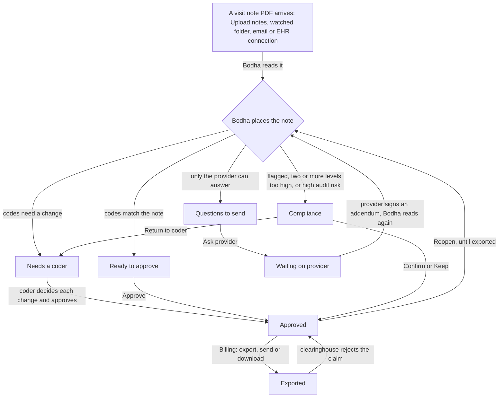
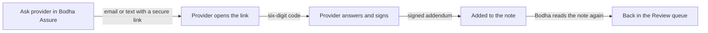

# Bodha Assure user guide

Bodha Assure checks each visit note against the codes billed for it before the claim goes out. Your
practice adds visit-note PDFs. Bodha reads each note, compares the billed CPT, ICD-10-CM and visit level
(E/M, the evaluation and management code such as 99214) with what the note documents, and quotes the
sentence in the note behind every suggested change. Each note is then put in front of the right person:
ready to approve, needs a coder, a question for the provider, or a compliance decision. Approved claims
are exported for your billing system or sent to your clearinghouse.

Practice staff sign in at www.bodhaai.co. Bodha HQ staff sign in at admin.bodhaai.co. A provider who is
asked a question does not sign in: they answer through a secure link. How signing in works, and what
everyone shares, is in [Shared by everyone](#shared-by-everyone).

## Roles at a glance

| Role, as the app shows it | What it is for | Main screens |
|---|---|---|
| Admin | Runs the practice: setup, team, plan and security. Can also do every review and billing task | Today, Inbox, Upload notes, Review queue, Compliance, Billing, Insights, Settings |
| Coder | Reviews notes, accepts or keeps each change, approves claims | Today, Inbox, Upload notes, Review queue |
| CDI specialist | Clinical documentation integrity: finds what the note is missing and asks the provider | Today, Inbox, Upload notes, Review queue |
| Compliance | Decides on flagged and high-risk notes, runs blind audits, reads the access log | Compliance, Today, Inbox, Upload notes, Review queue, Insights |
| Biller | Exports approved claims, sends them to the clearinghouse, reads payer remittances | Billing, Today, Inbox, Upload notes |
| Viewer | Follows the practice's figures and uploads notes; cannot open notes | Today, Upload notes, Insights |
| Organization admin | Looks after a group of practices: practices, people, combined billing, sign-in | The organization's Practices, Insights, Plan, Domains, Single sign-on |
| Platform admin (Bodha HQ) | Bodha staff who run the platform | Overview, Practices, Organizations, Spend, Usage, Activity log, Demo requests, Team, Security |
| Provider (no account) | Answers questions about their own visit note and signs an addendum | Questions about a visit note, opened from the secure link |

Every practice role can [upload notes](#uploading-notes), open [Help](#getting-help) and use their own
[Account page](#your-account-page); these, with appearance, signing in and switching practices, are
described once in [Shared by everyone](#shared-by-everyone). After signing in, billers start on
**Billing**, compliance on **Compliance**, HQ on **Overview**, and everyone else on **Today**.

## How a note moves

The five boxes in the middle are the lists the **Review queue** shows. A note is due 48 hours after its
day of service ends.

## Practice admin

The app calls this role **Admin**. You start on **Today**. Your sidebar holds **Today**, **Inbox**,
**Upload notes**, **Review queue**, **Compliance**, **Billing** (tabs **Ready to bill** and
**Remittances**), **Insights** (tabs **Overview**, **Quality**, **Access log** and **Usage**) and
**Settings** (tabs **Setup**, **Team**, **Plan** and **Security**), with **Search** and **Help**.

You can do everything a [coder](#coder), [CDI specialist](#cdi-specialist),
[compliance](#compliance) reviewer and [biller](#biller) can do. This section covers what only admins do.

### Today and the first day

- A new practice shows a **Get set up** checklist on Today: **Add your providers**, **Add your payers**,
  **Choose the checks**, **Invite your team**, **Set sign-in security** and **Choose a plan**. Each step
  has its own button; **Hide** puts the list away.
- The figures under **Waiting for review** (**Ready to approve**, **Needs a coder**, **Questions to send**,
  **Waiting on provider**, **Compliance**) each open the list they count. **Start reviewing** opens the
  first note up next.

### Work only admins can do

- Assign notes to anyone, and reassign a note someone else holds. Coders and CDI specialists can only
  take an unassigned note (**Assign to me**) or give back their own.
- Void any note that is not being read, and **Restore** a voided note (both ask for a reason). Coders can
  void only notes Bodha has not read yet. A note with an open provider request must have the request
  cancelled first.
- In **Insights**, **Quality**: assign training sets (**Training**, **Assign training**), run an
  evaluation of Bodha's accuracy (**Evaluation**, **Run evaluation**, and **Add notes** to the evaluation
  set), and turn **Auto-approve** on for a provider under **Autonomy** once the provider is shown as
  **Eligible**.
- In **Insights**, **Usage**: **Time per task** and **Stalls** show how long reviewing, the queue,
  uploading and billing export take for each role, and where people pause. Nothing about patients is
  recorded for these figures.
- In **Billing**, **Remittances**: set the **Appeal windows** for each plan type.

### Settings, Setup

The tab opens **Practice setup**, with a progress count and a list of sections marked **Complete**,
**Not complete** or **Needs attention**.

- **Practice details**, **Coding rules**, **Charge capture**, **Documentation rules**, **Compliance**,
  **Reports**, **Contacts**, **Patient registration** and **Software** are forms you fill in and **Save**.
- **Providers**: **Add provider** or **Import** a CSV file. Each provider has a name, credential,
  specialty, NPI (the 10-digit National Provider Identifier), **Usual place of service**, **Usual payer**
  and **Send questions by** (email or text). **More** holds credentialing details. A provider without an
  NPI shows **Add NPI**.
- **Insurance payers**: the **Payer list** (**Add payer** with the payer ID, plan type and claim filing
  code). Only active payers can be chosen at upload.
- **Payments**: **Charges** (**Add charge** or **Import**) gives the charge for each CPT or HCPCS code,
  which claims sent to a clearinghouse need.
- **Checks**: choose which checks Bodha runs and **Save checks**. Under **Level changes**, **Ask the
  provider to confirm E/M level changes** sends the provider a confirmation when an approved claim changes
  the visit level, and **Hold the claim until confirmed** keeps it out of billing until they answer.
- **Clearinghouse**: connect your clearinghouse for 837P claim files. Choose **Mode** (Test or
  Production) and how **Claims go by** (**SFTP** or **Portal upload**). For SFTP, fill in the host and
  sign-in, **Read host key**, then **Test connection** and **Save**. Before the first claim file, fill in
  **Practice details** (legal name, EIN, group NPI, street, city, state, ZIP+4, phone and billing
  contact), give each payer its payer ID, add a charge for every code you bill, and give each provider an
  NPI. Billing lists what each claim still needs.
- **Automatic intake** has two ways for notes to arrive without anyone opening Upload notes:
  - **Email**: **Get an address**, add **Allowed senders** (an address or a whole domain; a public mail
    domain such as gmail.com can only be allowed address by address), and **Send a test**. Every message
    received is listed, with the reason when it was refused (for example **Sender not allowed** or
    **Sender not verified**). A file is accepted only when Bodha can read the provider and date of
    service from page one with confidence.
  - **Watched folder**: Bodha's team sets the folder up with you. Turn on **Read dropped PDFs**, choose
    the **Place of service** and **Visit type**, and map each **Provider folder** to a provider (**Add
    folder**). Files go in the provider's folder, inside a folder named for the date of service, and are
    read about once a minute.
- **EHR connection**: Bodha pulls signed visit notes from your EHR over FHIR, the standard way EHRs share
  records. **Create key**, give the EHR vendor the JWKS URL and Key ID shown, then fill in the FHIR base
  URL, client ID, scopes, **Note types** and **Start date**, **Save** and **Test connection**. Bodha
  checks for new notes at most every 15 minutes. **Pause** and **Resume** stop and restart pulling.
  **Recent pulls** and **Documents** show what arrived and why anything was refused (for example **No
  provider with this NPI**).
- **Quality measures**: keep the **Standard list** of CMS quality (MIPS) measures or choose a **Custom
  list**. Under **Your measures**, **Add your own** describes a measure the practice tracks: when a visit
  is in scope, when it is out of scope, what the note must document, and up to four codes to report when
  met and when not met. **Edit** saves a new version; **Retire** ends it. These appear on the note review
  as **Practice measure**.

Notes from email, the watched folder and the EHR connection appear in **Recent uploads** like any other
upload. For email and the watched folder, each note's payer is the one page one names clearly, else the
provider's usual payer; notes from the EHR take the provider's usual payer.

### Settings, Team

- **Invite** opens **Invite your team**: a name, email and role for each person, **Add person** for more,
  then **Send invites**. A person who already has a Bodha Assure account is added to your practice and
  told by email; anyone else gets an invite to choose a password. The subtitle shows seats used.
- **Show** filters the list: **Everyone**, **Coders**, **Specialists**, **Compliance**, **Billers**,
  **Admin & viewer**. Change a role in the **Role** column.
- **More** for a person: **Activity**, **Reset two-step**, **Resend invite**, **Send password reset**,
  **Block**, **Unblock**, **Remove**.
- **Join requests** lists people who asked to join from your email domain: **Approve** (with a role) or
  **Decline**.
- **Email domains**: claim your email domain, prove it with a DNS **TXT record** (**Check DNS**) or an
  **Admin address** (**Send email**), then set **Joining** to **Off**, **Ask to join** or **Join
  automatically**, with the role new people get.

### Settings, Plan

The tab opens **Plan and billing**: the current plan, its standing (**Trial**, **Active**, **Payment
due**, **Ending**, **Canceled**, **Ended**), renewal or end date, and active providers and users.

- **Choose plan**, then **Pay with** (card or PayPal) and **Continue** to start a subscription.
  **Manage billing** opens your payment provider's page for the card and invoices; **Cancel at period
  end** stops renewal; **Contact sales** sends a message to Bodha.
- During a trial, the other pages show **Your trial ends in N days** with **Choose a plan**. If a payment
  fails it shows **Payment failed. Access continues until** a date, with **Update payment**. **Hide until
  tomorrow** puts the banner away for the day. Only admins see these banners.
- If your practice is billed with its organization, the page shows **Billed through** the organization
  instead, and the organization admins manage the plan.
- When the plan ends, admins can still sign in but only **Settings**, **Plan** opens, with **Your
  practice's plan has ended**, until a plan is chosen. Other roles cannot sign in until then, except the
  admins of the practice's organization ([Organization admin](#organization-admin)).

### Settings, Security

- **Two-step verification required for**: the roles that must enter a six-digit code at sign-in. New
  practices start with Admin and Compliance.
- **Sign out after inactivity**: 15 minutes, 30 minutes, 1 hour, 4 hours, 8 hours, 1 day or 7 days (the
  default).
- **Keep the access log for**: 7 to 10 years.
- **Single sign-on** connects your identity provider (SAML) so staff sign in with their work account.
  Copy the **Entity ID** and **Reply URL (ACS)** or **Download metadata** for your identity provider,
  then add its metadata, choose which verified **Domains** use single sign-on, whether to **Create people
  on first sign-in** and the **Role for new people** (never Admin), and **Test sign-in**. **Require single
  sign-on** turns off passwords for those domains except for the **Break-glass admins** you name. **Turn
  off single sign-on** removes it.

### What admins cannot do

- Reopen a note once it is exported (a claim the clearinghouse rejects comes back and can be reopened).
- Void a note while Bodha is reading it.
- Decide a compliance note they flagged themselves.
- See another practice without holding a role there (see
  [Working in several practices](#working-in-several-practices)).

## Coder

The app calls this role **Coder**. You start on **Today**. Your sidebar holds **Today**, **Inbox**,
**Upload notes** and **Review queue**, with **Search** and **Help**.

### Today

**Start reviewing** opens your next note: the first one assigned to you, else the first unassigned one.
When there is none it opens the queue on **My work**. The figures under **Waiting for review** open each
list, and **Up next** lists the notes due soonest.

### Review queue

- **Show notes** picks a list: **All**, **Ready to approve**, **Needs a coder**, **Questions to send**,
  **Waiting on provider** or **Compliance**, each with its count.
- **Views**: your built-in view is **My work** (notes assigned to you). **Save view** keeps the current
  filters under a name; **Saved views** deletes one.
- Filters: **Search**, **Provider**, **Assigned** (**Anyone**, **Mine**, **Unassigned**) and **Sort**
  (**Due date** or **Dollar impact**).
- **Review next** opens the first note ready to review. In **Ready to approve**, **Approve all N**
  approves every note on the page whose codes match the note.
- Tick notes to act on several at once: **Approve N**, **Assign to…** (to yourself), **Void N** (notes
  Bodha has not read) and **Clear**. **Undo** in the message puts approved notes back.
- **Read N again** sends notes that could not be read to be read again. **Remind** on a note waiting on
  the provider sends them a reminder.

### Reviewing a note

The note opens with the **Visit note** on one side, its sentences marked **Supported**, **Needs detail**
or **Not supported**, and the **Coding review** on the other.

1. **Show findings** narrows the list: **All**, **Changes**, **Questions**, **Risk**, **Guidance**.
   Findings are grouped as **Before you approve**, **Changes**, **Questions**, **Risk adjustment** and
   **Audit and wording**.
2. For each finding choose **Accept**, **Keep**, **Ask provider**, **Add** or **Skip**. Keeping a billed
   code that Bodha would change asks for a reason. **Accept all supported** accepts every supported
   change at once. The **Claim** bar at the bottom updates as you decide, with the **Estimated Medicare
   national** amount.
3. **Billed codes**, **Edit** corrects what was billed (with a reason). **Comment** starts a thread on a
   finding or the note, and naming a colleague tells them in their Inbox. **History** shows every reading,
   code revision, decision, question and export.
4. The note's tools: **Assign to me** or **Unassign**, **Visit type**, **Payer**, **Read again with this
   payer** (when the payer changed after the read), **Defense packet** (a PDF of the evidence for an
   audit) and **Void note**. The top bar has **Review queue** to go back, **Original PDF** and **Replace
   PDF** (for an amended note).
5. **Approve**. The first time, Bodha asks you to add your signature (**Approving needs your
   signature.**). The message **Approved** with the patient's name has **Undo**, and the next note opens.

When the note needs something only the provider can say, see [Asking the provider](#asking-the-provider).
When it looks risky, **Flag for compliance** with a reason sends it to the Compliance list.

An approved note shows **Approved** with **Reopen** until it is exported. A note Bodha could not read
shows **Read again**.

### Asking the provider

1. With questions open, the claim bar shows **Ask** the provider's name and the number of questions. The
   approve button then reads **Approve without asking**.
2. In the dialog, edit each question's wording and untick any you do not want to send. Questions stay
   neutral and never mention payment.
3. **Send by** **Text message** or **Email**; both carry a **Secure link**. Text message is offered only
   when the practice can send texts.
4. **While waiting**: **Hold the claim until answered** or **Allow approval before an answer**, then
   **Send**.

The note moves to **Waiting on provider**. **Sent to the provider** shows each request as **Waiting for
answer**, **Answered**, **Expired** or **Cancelled**, with **Remind** and **Cancel request**. Bodha sends
up to two reminders on its own and the link expires after three days. When the provider signs, their
answers are added to the note as an addendum, Bodha reads the note again, and your Inbox says the
provider answered.

### What coders cannot do

- Make compliance decisions or open the **Compliance** page.
- Assign notes to other people, or take a note assigned to someone else.
- Void a note Bodha has read, or restore a voided note (ask an admin).
- Open **Billing**, **Insights** or **Settings**.

## CDI specialist

The app calls this role **CDI specialist** (clinical documentation integrity). You start on **Today**.
Your sidebar holds **Today**, **Inbox**, **Upload notes** and **Review queue**, with **Search** and
**Help**.

- **Send questions** on Today opens the Review queue on **Questions to send**, which is also your
  built-in view.
- Open a note and work its **Questions** findings: adjust the wording and send them as described in
  [Asking the provider](#asking-the-provider). The note summary shows a **CDI score**.
- You can accept or keep code changes ([Reviewing a note](#reviewing-a-note)), comment, **Flag for
  compliance**, and **Assign to me**.
- Answers arrive in your **Inbox**, and expired requests are reported there too.

What you cannot do: approve a claim (there is no Approve button for you), make compliance decisions,
void, read again, replace the PDF or change the visit type or payer, assign notes to others, or open
**Compliance**, **Billing**, **Insights** or **Settings**.

## Compliance

The app calls this role **Compliance**. You start on the **Compliance** page. Your sidebar holds
**Today**, **Inbox**, **Upload notes**, **Review queue**, **Compliance** and **Insights** (tabs
**Overview**, **Quality** and **Access log**), with **Search** and **Help**. Your built-in queue view is
**Flagged**.

### How notes reach you

A note goes to Compliance when someone flags it, when the billed visit is two or more levels higher than
the note supports, or when it carries a high audit risk.

### The Compliance page

1. **Show notes**: **All**, **Billed too high**, **High risk** or **Flagged**. A **Pattern** banner points
   out repeated problems.
2. The first note is shown in full: **Billed**, **Supported**, **In the note**, **Flagged because**,
   **Flagged by** and **Audit risks**. **Open note** opens the full review.
3. Decide:
   - **Confirm** the supported code: the claim is corrected and approved.
   - **Keep** the billed level: give a reason in **Keep the billed level** and **Keep and approve**.
   - **Return to coder**: choose a **Reason for returning** (**Level not supported**, **Documentation
     missing**, **Coding error**, **Ask the provider**, **Payer policy** or **Other**). The note goes
     back to **Needs a coder** marked returned, and the person who flagged it (else the one assigned,
     else the last to decide on it) is told in their Inbox.
4. The next note takes its place; the rest are under **More notes for compliance**.

Compliance decisions are signed, like approvals. The person who flagged a note cannot clear it. The
**Same day** panel checks each provider's day for **Time over a plausible day**, **Cloned text** and a
high share of the top visit levels.

### More of your work

- In the Review queue you can accept or keep changes, approve ordinary notes and flag notes, as in
  [Reviewing a note](#reviewing-a-note). On a note you can also download the **Audit package** and
  **Show removed** comments.
- **Insights**, **Quality** has **Blind audits**, **Evaluation** and **Autonomy**. **Start audit** opens
  **Start a blind audit**: choose the scope (practice, provider or specialty), the dates, the number of
  notes and the reviewers. Reviewers code each note without seeing Bodha's answer, and the results show
  **Agreement with the auditor** for the visit level, diagnoses and modifiers. You can read evaluation
  runs and each provider's auto-approval eligibility; running an evaluation and switching auto-approval
  are for admins.
- **Insights**, **Access log** lists who opened, changed or exported each note. Filter by person, dates,
  action, note, patient name or date of birth, and **Export** the result.
- **Insights**, **Overview** is described under [Viewer](#viewer).

What you cannot do: ask the provider, assign notes, void, read again, replace the PDF or change the
visit type, open **Billing** or **Settings**, or see **Usage**.

## Biller

The app calls this role **Biller**. You start on **Billing**. Your sidebar holds **Today**, **Inbox**,
**Upload notes** and **Billing** (tabs **Ready to bill** and **Remittances**), with **Search** and
**Help**. **Review queue** is not in your sidebar, but Today's lists, **Up next** and Search still open
notes for you to read.

### Ready to bill

- **Billing summary**: **Visits**, **Ready to bill** and **Exported today** (click either to list those
  visits), **Held for provider**, **Changed in review**, **As billed**.
- **Show visits**: **Not exported**, **Exported**, **Exported today** or **All**. The **Approved visits**
  table shows each patient, provider, **Final codes**, the estimate, whether the codes changed in review,
  who approved, and a **Defense packet**.
- **Export N claim lines** (choose the **Format**, CSV or JSON) downloads the visits not yet exported, up
  to the number on the button, and marks them exported. In **Exported**, **Export files** lists earlier
  files to download again.

### Sending to the clearinghouse

When an admin has connected a clearinghouse, a **Claim** column shows each visit as **Missing
information**, **Ready**, **Sending**, **Sent**, **Accepted**, **Rejected** or **Not delivered**.

1. **Details** opens **Claim details**: the payer, patient name, birth date, sex and address, the
   relationship to the subscriber, member ID and group number. **Save**.
2. **Send N claims** delivers the 837P claim file (the standard electronic claim) for every visit marked
   **Ready** when claims go by SFTP. **Download 837P** saves the same file for practices that upload to
   their clearinghouse's portal.
3. **Claim files** lists each file sent, with its acknowledgements (**accepted** and **rejected** counts,
   **File accepted**, **File rejected** or **File pending**). With SFTP Bodha collects responses about
   every ten minutes; **Upload response** adds a clearinghouse response file yourself.
4. A rejected claim comes back to **Ready to bill** with the reason, and your Inbox says **A claim was
   rejected**. Fix the claim details yourself with **Details**, or ask a coder, compliance reviewer or
   admin to reopen the note when its codes need correcting, then send it again.

### Remittances

**Upload 835** reads the payer's electronic remittance file. **Files** lists each one; choose a file to
see its lines and **Show lines**: **All**, **Downcoded**, **Denied** or **Unmatched**. **Draft appeal**
writes an **Appeal letter** to **Copy** or **Download**, with the **Defense packet**, before the **Appeal
by** date.

What you cannot do: decide findings, approve, reopen, flag or ask the provider (you can read notes and
comment), assign notes, set the appeal windows, set up the clearinghouse or charges, or open
**Insights** or **Settings**.

## Viewer

The app calls this role **Viewer**. You start on **Today**. Your sidebar holds **Today**, **Upload
notes** and **Insights**, with **Help**.

- **Today** shows how many notes wait in each list and the uploads **Being read**. The figures are not
  links for you.
- **Upload notes** works for you as for everyone ([Uploading notes](#uploading-notes)).
- **Insights** shows the practice's figures for a **Period** (**7 days**, **14 days**, **30 days** or
  **Quarter**): **Notes read**, **Billed on time**, **Matched the note** and the **Est. Medicare national
  difference**, then **Notes read per day**, **Billed codes vs. the note**, **Providers**, **Estimated
  Medicare national difference**, **Coder productivity**, **Visit levels vs. CMS** and **Provider
  queries**. These figures are not links.

What you cannot do: open notes or the Review queue (the provider names in **Recent uploads** link there,
and the page answers **Your role can't open this page.**), search, use the Inbox, comment, or open
**Billing** or **Settings**.

## Organization admin

An organization groups practices. Bodha HQ makes someone an organization admin; that person also holds a
role in at least one of the practices, which is how they sign in. Open the organization from the account
menu (your name at the bottom of the sidebar), where it is listed as the organization's name followed by
**Organization**. It has five tabs.

- **Practices**: each practice with its plan, **Combined billing**, users and active providers.
  - Turn **Combined billing** on to bill a practice through the organization's plan.
  - **New practice** adds a practice (name, time zone, and agreement to the terms).
  - **Add person** invites someone with a role in one or more of the practices.
  - **Open** switches you into a practice where you have a role. **Get access** gives you a role in a
    practice where you have none: choose the role, give a reason, and the practice's admins are told by
    email.
- **Insights**: a **Period**, totals for **All practices** (**Notes read**, **Approved**, **On time**,
  **Estimated difference**) and a row for **Each practice**.
- **Plan**: **Plan and billing** for the **Combined plan**, with the **Practices in combined billing**.
  Choosing, paying, managing and cancelling work as on a practice's Plan tab.
- **Domains**: the organization's **Email domains**, claimed for a chosen practice and verified the same
  way as on a practice's Team tab.
- **Single sign-on**: the same settings as on a practice's Security tab, covering the organization's
  practices.

When the organization's plan ends you can still sign in, but only the organization's **Plan** opens, and
the account menu offers only the organization and **Sign out**, until the plan is renewed.

What you cannot do: open a practice's notes without a role there (use **Get access**, which is
recorded), add or remove organization admins, or take a practice out of the organization. Bodha HQ does
those.

## Bodha HQ

Bodha HQ staff sign in at admin.bodhaai.co. The app shows the role as **Platform admin**. There is one HQ
role: every HQ account can do everything below. Two-step verification is always asked, and HQ is signed
out after 7 days without use. HQ accounts cannot open practice screens or patient notes.

The sidebar holds **Overview**, **Practices**, **Organizations**, **Spend**, **Usage**, **Activity log**,
**Demo requests**, **Team** and **Security**. **Search** finds an organization, practice or email.

- **Overview**: the **Platform** figures. **Organizations** opens the organizations list,
  **Practices** opens the live practices, and **Model cost this month** opens Spend for the month; the
  others (people, notes read and waiting, failed reads, model tokens and cost in 24 hours) are not links.
  **Needs attention** and **Most waiting** list practices to look at.
- **Practices**: **Add practice** (name, first admin, plan, seats, renewal date, time zone). **Show**
  filters by **All**, **Live**, **Active**, **Trial**, **Ending soon**, **Ended**, **Blocked** or
  **Closed**. **More** for a practice: **Edit**, **Resend admin invite**, **Send admin password reset**,
  **Add admin** (with a reason), **Renew** (plan and length), **Block** or **Unblock**, **Close practice**
  (records kept) and **Purge records** (type the practice's name to confirm). **Places of service** keeps
  the list every practice chooses from. A practice's own page has **People**, **Plan & renewal**,
  **Spend**, **Activity** and **Places**.
- **Organizations**: **Add organization**. An organization's page has **Practices** (**Add practice**,
  bill a practice with the organization, **Remove from organization**), **Admins** (**Add admin** with an
  email and a reason, **Remove**), **Plan & renewal** and **Spend**, with **Renew**, **Edit**, **Close
  organization** and **Purge records**.
- **Spend**: model cost by practice and provider for a range (**This month**, **Last month**, **Last 30
  days**, **This year**, or your own dates), with **Download CSV**.
- **Usage**: time per task and stalls across practices for a period.
- **Activity log** (the page is headed **Activity**): every HQ action, filtered by search, action and
  practice, with **Export**. **Verify audit log** checks that no entry was changed or removed.
- **Demo requests**: requests sent from the website.
- **Team**: **Invite** another HQ account; **More** offers **Resend invite**, **Deactivate** and
  **Reactivate**.
- **Security**: your signed-in devices, recovery codes and **Appearance**.

The account menu has **Take the tour** and **Sign out**. HQ has no Help page.

## Provider answering through the secure link

Providers do not have an account. When a coder, CDI specialist or admin asks a question, the provider gets
an email or text message with a secure link.

1. Open the link. The page **Questions about a visit note** asks you to **Verify it's you**: **Send
   code**, then type the **Six-digit code** sent to your email or phone and **Verify**. **Send a new
   code** if it does not arrive.
2. Read **Your note** (**Open PDF** shows the original) and the **Questions**, each quoting the part of the
   note it is about.
3. Answer each question, with an optional **Comment**. Choosing **Other** asks for **Your answer**.
4. Check the **Addendum preview**, then sign: **Use my saved signature** or **Use a new signature**, and
   tick **Remember my signature for this practice** if you like.
5. **Sign and add to note**. The page confirms **Addendum signed** and the visit it was added to.
6. If you have more open requests, **Other requests** lists them and **Next request** opens the next one.

A **Visit level change** request asks you to **Confirm** or **Disagree** with a changed visit level; a
disagreement needs a comment. Then **Send**.

A link stops working after three days, or once the request is answered or cancelled (**This request is
closed.**). If the page says **Verification expired. Send a new code to continue.**, send a new code. The
provider sees only their own requests and cannot change codes.

## Shared by everyone

### Uploading notes

Every practice role can upload. Open **Upload notes**, or drag PDFs onto any page (**Drop PDF notes to
upload**) to be taken there with the files.

1. Drop the files on **Drop PDF notes here** or use **Choose files**. Only PDF files are added.
2. Bodha reads page one of each file and fills in what it finds (**Read from note**): patient, provider,
   date of service, place and payer. A file named like `2026-11-25 - REYES MARISOL - 99215.pdf` fills
   the patient and billed code.
3. **All files** sets the **Provider for all**, **Date of service for all**, **Place of service for all**,
   **Payer for all** (recommended, never required) and **Visit type** in one go.
4. Check each row's **Status**: **Ready**, **Check** (Bodha was not sure; look and **Confirm**), **Fix
   code** (a billed code is not valid), **Duplicate** (the same file twice; **Keep** to upload it anyway),
   **Already uploaded** (left out) or **Optional** (no billed codes). **Add files** below the table adds
   more.
5. **Start reading N notes**. The page confirms how many are being read; **Go to Today** or **Upload
   more**.

**Recent uploads** lists every batch with who uploaded it, how many notes it holds and whether they have
been read, including batches from email, the watched folder and the EHR connection. If no provider has
been added yet the page says **Add a provider in Practice setup first.**, and an admin sees **Open
Practice setup**.

### Inbox

For everyone who can open notes: answers from providers, mentions, notes returned by compliance,
assigned training, join requests, rejected claims and plan notices. **Mark all read** clears the count
in the sidebar.

### Search, Assigned to you and keyboard shortcuts

- **Search** (or Ctrl+K, or /) finds any note by patient, provider, file name or code, including approved
  and exported ones. It is there for everyone who can open notes.
- **Assigned to you**, on Today and on the **Training** page, lists blind audits and training sets you are
  asked to code. **Code** opens the next note; training then shows **How you compared** with the final
  claim and Bodha.
- Press **?** on any screen to see its shortcuts. In a note, Y accepts a change, N keeps the billed code,
  A approves and Q asks the provider.

### Your Account page

Choose your name at the bottom of the sidebar, then **Account**. It holds:

- **Practices**: the practices you belong to, **Leave** one, or **New practice**.
- **Signature** (for admins, coders, CDI specialists and compliance): **Add signature** by drawing,
  typing or uploading a photo, then **Adopt signature**. Approvals and compliance decisions are signed
  with it.
- **Signed-in devices**: **Sign out** one device or **Sign out everywhere else**.
- **Recovery codes**: how many are left, and **New codes** with a current six-digit code.
- **Appearance**, below.
- **Email**: **Email me a daily summary**, for everyone who can open notes.

### Appearance

**Appearance** sets **Theme** (**System**, **Light**, **Dark**), **Text size** (**Default**, **Large**,
**Larger**) and **Reduce motion** (**System**, **On**, **Off**). System follows your computer's own
setting. Changes apply at once, are saved to your account so they follow you to other computers, and the
device remembers them for the sign-in page. HQ finds Appearance on its **Security** page.

### Signing in

- Enter your **Email** and **Password**, then **Continue**. **Forgot password?** sends a reset link.
- **Continue with Google**, **Microsoft** or **Yahoo** appear when they are turned on. Use the same email
  your account has.
- If your email's domain uses single sign-on, **Continue with single sign-on** appears. When single
  sign-on is required the password field is hidden; break-glass admins choose **Use a password**.
- **Two-step verification**: enter the six-digit code from your authenticator app. The first time,
  **Set up two-step verification** shows a QR code to scan, then **Save your recovery codes**. If you lose
  your phone, **Use a recovery code**; if you lose both, ask an admin to **Reset two-step**.
- A new team member opens the invite email, chooses a password (**Set password**) and is signed in. A new
  practice starts from **Start a free trial**.

If sign-in says **Your practice's plan has ended.**, ask your admin to choose a plan. If it says **Your
practice has no free seat. Ask an admin.**, an admin needs to free or add a seat.

### Staying signed in

Bodha Assure keeps you signed in on a device until you have not used it for 7 days, unless your admin
chose a shorter time (15 minutes up to 7 days). After 30 days you sign in again even if you used it every
day. When you are signed out for not using it, the sign-in page says **Signed out after inactivity**.
Signing out, **Sign out everywhere else**, a password change, a two-step reset and being blocked end
sessions at once. HQ always stays signed in for 7 days without use.

### Working in several practices

One account can belong to several practices, with a different role in each. An invite to an existing
account adds the practice.

- When you belong to more than one, the practice's name under **Bodha Assure** at the top of the sidebar
  is a menu: choose another practice to switch. The account menu also lists each practice with your role
  there.
- Switching may ask for your two-step code if the other practice requires it for your role.
- **Leave** a practice from the account menu or your Account page. **New practice** starts another
  practice, on a free trial, with you as its admin (when self sign-up is available).

### The first sign-in tour

The first time you sign in, a short tour walks through each sidebar entry you can open (**Next**,
**Back**, **Skip tour**, **Done**). **Take the tour** in the account menu or on Help shows it again.

### Getting help

**Help** in the sidebar has the guides for your role: **Upload notes**, **Review notes**, **Ask the
provider**, **Compliance**, **Billing**, **Two-step verification and recovery codes** and **Keyboard
shortcuts**. For a locked account or lost two-step device, ask your practice admin. An admin who is
locked out can ask Bodha HQ for a password reset. **Contact sales** on the Plan tab reaches Bodha about
plans.
